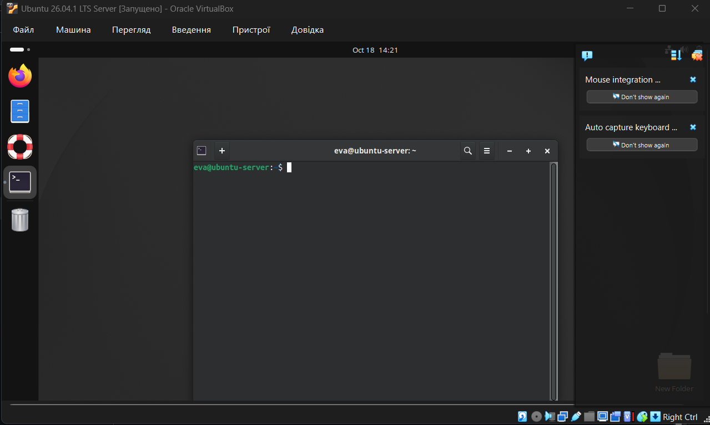

> Оформлено студенткою  
> групи КСМ-43б   
> Адаменко Є. В.  

<h1 align="center"> Лабораторна робота №8</h1>

## Завдання попередньої підготовки
### Завдання 1 - Прочитайте короткі теоретичні відомості до лабораторної роботи та зробіть невеликий словник базових англійських термінів з питань призначення команд та їх параметрів.
- kernel - ядро операційної системи, завантажується під час старту й керує всією роботою системи
- pseudo filesystem - псевдофайлова система, що виглядає як справжні файли на диску, але існує лише в пам'яті
- daemon - фоновий процес, який виконує службові завдання, наприклад ведення лог-файлів
- log file - журнал (файл) із повідомленнями про роботу ядра та процесів
- log rotation - перейменування старих лог-файлів і створення нового файлу з початковою назвою
- swap - (простір підкачки) місце на диску, яке використовується як фізична пам'ять, коли RAM бракує
- loopback (`lo`) - інтерфейс зворотного зв'язку, спеціальний мережевий пристрій, яким система користується для відправлення даних самій собі
 

### Завдання 3 - Пройдіть тестування у курсі NDG Linux Essentials за такими темами:
- Chapter 13 Exam
- Chapter 14 Exam

 
 

### Завдання 4 - На базі розглянутого матеріалу дайте відповіді на наступні питання:
#### 4.1 Розкрийте поняття “псевдо файлової системи”, для чого воно потрібно системі?
##### Псевдо файлова система виглядає як справжні файли й каталоги на диску, але існує лише в пам'яті комп'ютера й здається розташованою на пристрої, де знаходиться коренева файлова система. Вона має вигляд ієрархічного дерева каталогів, файлів і підкаталогів від кореня системи. Вона потрібна системі для того, щоб ядро могло надавати програмам і користувачам інформацію про процеси, пам'ять та обладнання в зручному вигляді файлів, без зберігання цих даних на диску
 

#### 4.2 Чому користувачі не так часто звертаються на пряму до каталогу /proc, яким чином з нього можна отримати інформацію?
##### Дані з `/proc` рідко читають напряму, тому що простіше використовувати команди, які виводять цю ж інформацію в зручному вигляді.
 

#### 4.3 Яке призначення файлів /proc/cmdline, /proc/meminfo та /proc/modules?

- `/proc/cmdline` - інформація, яка була передана ядру під час його першого запуску (параметри командного рядка та спеціальні інструкції)
- `/proc/meminfo` - інформація про використання пам'яті ядром 
- `/proc/modules` - список модулів, завантажених у ядро 
 

#### 4.4 Яке призначення команди free?
##### Команда `free` показує обсяг пам'яті, що використовується в системі. Без параметрів вона виводить знімок використання пам'яті на цей момент. Основні параметри:
- `-s n` - оновлювати вивід кожні `n` секунд 
- `-m` - виводити значення в мегабайтах
- `-g` - виводити значення в гігабайтах 
 

#### 4.5 Для чого потрібні лог-файли, наведіть приклади їх застосування?
##### Лог-файли це файли, у які записується інформація про роботу ядра та процесів у системі. Вони потрібні для усунення збоїв у системи та для визначення спроб несанкціонованого доступу
##### Приклади застосування:
- файл `/var/log/auth.log` містить інформацію про автентифікацію. Викликають командою `tail -5 /var/log/auth.log`
- щоб знайти причину проблем з USB-пристроєм, повідомлення ядра фільтрують командою `dmesg | grep -i usb`
- `/var/log/boot.log` - повідомлення про запуск служб під час старту системи
- `/var/log/secure` - повідомлення від процесів, які вимагали автентифікації (наприклад, вхід у систему)
 

#### 4.6 Яке призначення файлу /var/log/dmesg?
##### Файл `/var/log/dmesg` містить повідомлення ядра, створені під час запуску системи. 
 

#### 4.7 Для чого розроблено FHS?
##### FHS (Filesystem Hierarchy Standard) - стандарт, підтримуваний Linux. Це набір правил і рекомендацій про те, як дистрибутиви мають організовувати файли й каталоги. Стандарт допомагає однаково розміщувати їх у різних дистрибутивах. FHS також визначає чотири ієрархії каталогів: кореневу `/`, `/usr`, `/usr/local` та `/var`. Це лише рекомендації, їх можуть порушувати як цілі дистрибутиви, так і адміністратори окремих машин.
##### Стандарт класифікує каталоги двома способами:
- придатний чи ні до спільного використання
- статичний чи змінний вміст (чи змінюються файли з часом)
 

#### 4.8 Які основні команди є у Linux для перегляду та конфігурації мережі
| Команда | Призначення |
|---|---|
| `ifconfig` | показує та тимчасово змінює конфігурацію мережевих інтерфейсів |
| `ip` | універсальна команда для налаштування й керування мережею |
| `route` | показує таблицю маршрутизації |
| `ping` | перевіряє, чи доступний інший комп'ютер |
| `netstat` | показує мережеві з'єднання, таблицю маршрутизації, відкриті порти |
| `ss` | показує статистику сокетів та встановлені з'єднання |
| `dig` | запитує DNS-сервер і перевіряє його роботу |
| `host` | зіставляє ім'я хоста й IP-адресу через DNS |
| `ssh` | підключення до іншого комп'ютера по мережі |

 
 

## Хід роботи
### Завдання 1 - Початкова робота в CLI-режимі в Linux ОС сімейства Linux: запустіть віртуальну машину Ubuntu_PC 

  
 

### Завдання 2 - Опрацюйте всі приклади команд, що представлені у лабораторних роботах курсу NDG Linux Essentials - Lab 13: Where Data is Stored та Lab 14: Network Configuration. Створіть таблицю для опису цих команд
| Назва команди | Її призначення та функціональність | 
|---|---|
| `su` | Змінює поточного користувача на root | 
| `ls /proc` | Переглядає вміст каталогу `/proc` |
| `cat /proc/1/cmdline; echo` | Виводить команду, якою запущено процес із PID 1. Команда `echo` без аргументів переносить наступну команду на новий рядок | 
| `ps -p 1` | Показує інформацію про процес із PID 1 |
| `cat /proc/cmdline` | Показує аргументи, передані ядру під час завантаження |
| `ping localhost > /dev/null` | Запускає `ping` у режимі переднього плану (foreground), а вивід перенаправляє у `/dev/null` |
| `ping localhost > /dev/null &` | Знак `&` запускає процес у фоновому режимі та виводить номер завдання (job) і PID |
| `jobs` | Показує завдання, запущені в поточному терміналі |
| `fg %1` | Переводить завдання №1 з фонового режиму на передній план |
| `bg %1` | Продовжує виконання призупиненого завдання №1 у фоновому режимі |
| `kill %3` | Завершує третє завдання |
| `killall ping` | Завершує всі процеси з іменем `ping` | 
| `top` | Показує процеси в реальному часі (оновлення кожні кілька секунд) |
| `sleep 888888 &` | Запускає у фоні процес, який "чекає" вказаний час |
| `ps` | Показує процеси поточної оболонки (PID, TTY, TIME, CMD) |  
| `kill PID` | Завершує процес за його PID |
| `ps -e` | Показує всі процеси системи |
| `ps -o pid,tty,time,%cpu,cmd` | Параметр `-o` задає, які стовпці виводити | 
| `ps -o pid,tty,time,%mem,cmd --sort %mem` | Сортує вивід за стовпцем (`+` - за зростанням, `-` - за спаданням) | 
| `free` | Показує загальне використання оперативної пам'яті та підкачки |
| `ls /var/log` | Показує файли журналів у `/var/log` |
| `ssh localhost` | Підключення до локального комп'ютера по SSH |
| `tail -5 /var/log/auth.log` | Показує останні 5 рядків журналу автентифікації |
| `ifconfig` | Показує мережеві інтерфейси та їх IP-адреси |
| `route` | Показує таблицю маршрутизації (шлюз за замовчуванням і локальна мережа) |
| `grep 127.0.0.1 /etc/hosts` | Перевіряє, що в `/etc/hosts` є запис для адреси `127.0.0.1` |
| `ping -c4 localhost` | Перевіряє, чи відповідає `localhost` на чотири запити |
| `cat /etc/resolv.conf` | Показує налаштування DNS-серверів |
| `dig localhost.localdomain` | Перетворює ім'я `localhost.localdomain` на IP-адресу через DNS-сервер |
| `dig cserver.example.com` | Перетворює повне доменне ім'я (FQDN) на IP-адресу |
| `dig -x 192.168.1.2` | Визначає ім'я хоста за IP-адресою |
| `netstat --help` | Показує довідку з параметрів `netstat` |
| `netstat -tl` | Показує TCP-порти, на яких працюють служби, імена служб виводяться словами |
| `netstat -tln` | Те саме, але адреси та порти виводяться числами (`-n`). `-t` — TCP, `-l` — прослуховування |
| `ss` | Показує встановлені з'єднання між комп'ютерами |
| `sudo /etc/init.d/bind9 restart` | Перезапускає DNS-сервер |

 
 

### Завдання 3 -  Виконайте практичні завдання у терміналі:
#### 3.1 в даній лабораторній роботі використовувалась команда cat, дослідіть її можливості та опишіть для яких задач вона призначена;

 

#### 3.2 продемонструйте приклади, коли команда cat використовується для створення файлу, перегляду вмісту файлу, перенаправлення інформації у інший файл, склеювання декількох файлів в один;

 

#### 3.3 які параметри команди cat треба використати, щоб пронумерувати рядки файлу, відобразити недруковані символи, видалити порожні рядки?  

 

#### 3.4 опишіть можливості команди dig та наведіть приклади;

 

#### 3.5 опишіть можливості команди netstat та наведіть приклади.

 
 