> Оформлено студенткою  
> групи КСМ-43б   
> Адаменко Є. В.  

<h1 align="center"> Лабораторна робота №9</h1>

## Завдання попередньої підготовки
### Завдання 1 - Прочитайте короткі теоретичні відомості до лабораторної роботи та зробіть невеликий словник базових англійських термінів з питань призначення команд та їх параметрів.
- administrative privileges - права, потрібні для виконання команд, що змінюють систему
- primary group - група, яка визначена в `/etc/passwd`
- supplementary (secondary) group - додаткова група, членство в якій задається в `/etc/group`
- UPG (User Private Group) - група, яка автоматично створюється разом з користувачем, має те саме ім'я, а єдиним її членом є цей користувач
- login shell - оболонка, у якій користувач опиняється після входу
- skeleton directory - каталог-шаблон, його вміст копіюється в домашній каталог нового користувача
 
 

### Завдання 3 - Пройдіть тестування у курсі NDG Linux Essentials за такими темами:
- Chapter 15 Exam
- Chapter 16 Exam
 

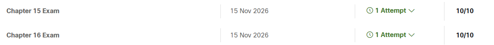
 
 

### Завдання 4 - На базі розглянутого матеріалу дайте відповіді на наступні питання:
#### 4.1 Розкрийте поняття UPG, коли їх доцільно використовувати?
##### UPG (User Private Group) - приватна група користувача. У деяких дистрибутивах під час створення облікового запису користувача автоматично створюється група з тим самим ім'ям, де єдиним учасником цієї групи є сам користувач. Доцільно використовувати коли файли кожного користувача мають за замовчуванням бути закритими від інших, бо спільна група не потрібна
 

#### 4.2 Якими командами можна створити групи користувачів? Наведіть приклади
##### Групи створюють командою `groupadd` з обов'язковим аргументом - назвою групи
- `groupadd development` - створює групу development
- `groupadd -g 1005 research` - створює групу з указаним GID
- `groupadd -r sales` - створює системну групу
- `getent group development` - перевіряє групу development
 

#### 4.3 Якими командами можна змінити налаштування груп користувачів? Наведіть приклади
- `groupmod -n` - змінює ім'я групи (доступ до файлів зберігається)
- `groupmod -g` - змінює GID групи
- `groupdel` - видаляє групу
- `usermod -aG` - додає користувача до додаткової групи (`-a` зберігає наявні групи)
- `usermod -G` - задає повний список додаткових груп (без `-a` попередні групи видаляються)
- `usermod -g` - змінює основну групу користувача
- `useradd -G` - задає додаткові групи під час додавання нового користувача
 
 

## Хід роботи
### Завдання 1 - Початкова робота в CLI-режимі в Linux ОС сімейства Linux: запустіть віртуальну машину Ubuntu_PC 
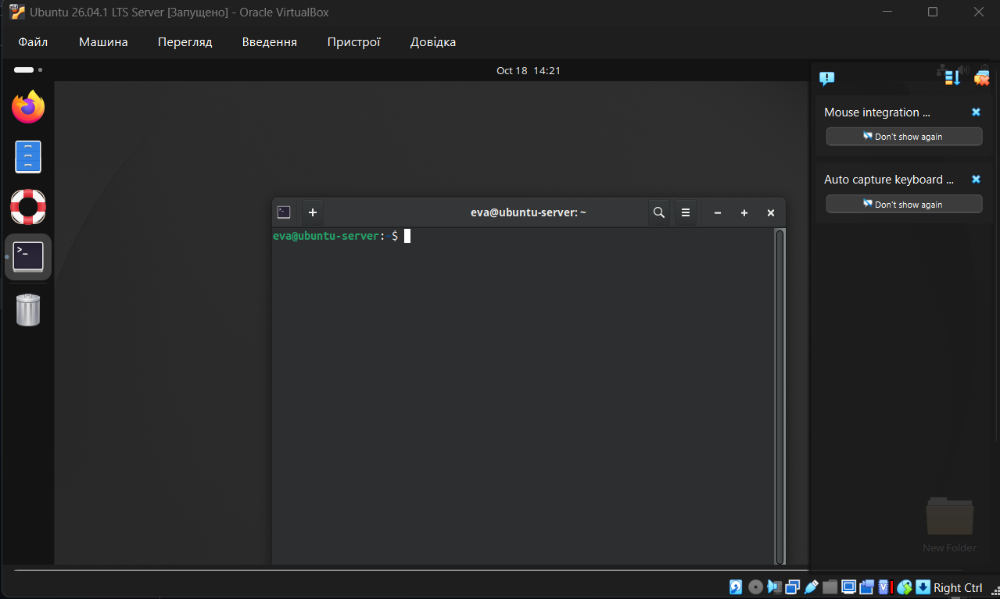
  
 

### Завдання 2 - Опрацюйте всі приклади команд, що представлені у лабораторних роботах курсу NDG Linux Essentials - Lab 15: System and User Security та Lab 16: Creating Users and Groups. Створіть таблицю для опису цих команд

| Назва команди | Її призначення та функціональність | 
|---|---|
| `su -` | Запускає оболонку від імені root |
| `id` | Показує поточного користувача: UID, основну групу та групи, до яких він належить |
| `exit` | Виходить з оболонки іншого користувача і повертає в оболонку початкового |
| `sudo head /etc/shadow` | Виконує команду від імені root, показує перші рядки файлу |
| `head /etc/passwd` | Показує перші 10 рядків файлу облікових записів |
| `grep sysadmin /etc/passwd` | Виводить запис про конкретного користувача |
| `ls -l /etc/shadow` | Показує права на файл паролів |
| `sudo head -3 /etc/shadow` | Показує перші три рядки /etc/shadow з правами адміністратора |
| `getent passwd sysadmin` | Отримує запис користувача з бази passwd та мережевих служб |
| `man 5 passwd` | Довідка з формату файлу /etc/passwd |
| `id root` | Показує дані вказаного користувача |
| `who` | Показує список користувачів, які зараз увійшли в систему |
| `w` | Докладніший список користувачів: навантаження, час простою, використання CPU, поточна команда |
| `last` | Історія входів з /var/log/wtmp |
| `groupadd -r research` | Створює системну групу research |
| `getent group research` | Показує запис групи research (ім'я, GID, список учасників) |
| `grep sales /etc/group` | Показує запис групи sales у файлі /etc/group |
| `groupmod -n clerks sales` | Змінює назву групи sales на clerks |
| `groupmod -g 10003 clerks` | Змінює GID групи |
| `groupdel clerks` | Видаляє групу clerks |
| `nano /etc/default/useradd` | Редагування файлу значень за замовчуванням |
| `useradd -G research -c 'Linux Student' -m student` | Створює користувача student: додаткова група - research, коментар - "Linux Student", `-m` - створити домашній каталог, основна група - student |
| `grep student /etc/passwd`, `grep student /etc/group` | Перевіряє запис користувача й групи, у яких він перебуває |
| `usermod -aG research sysadmin` | Додає користувача sysadmin до додаткової групи research |
| `getent passwd student`, `getent shadow student` | Перегляд записів користувача в базах passwd та shadow |
| `passwd student` | Задає пароль користувача |
| `last`, `last student` | Історія входів, за ім'ям користувача виводяться лише його записи |
| `usermod -L student` / `usermod -U student` | Блокує/розблоковує обліковий запис |
| `userdel -r student` | Видаляє користувача разом із домашнім каталогом і поштою |

 
 

### Завдання 3 - Виконайте наступні практичні завдання у терміналі наступні дії (продемонструвати скріншоти):
#### 3.1 - виведіть інформацію про поточного користувача різними способами (підказка використовуйте команди id та grep);
##### Команда `whoami` виводить лише ім'я користувача. `id` -  UID, основну групу та усі групи. `grep $USER /etc/group` - групи, у списку яких є користувач
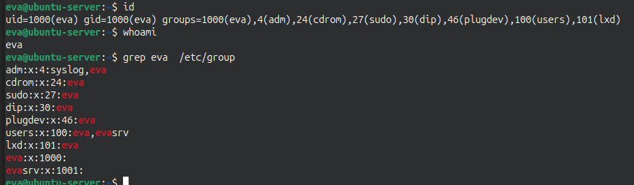
 

#### 3.2 - попрактикуйте в терміналі команди last, w та who. Порівняйте результати виводу кожної команди, які деталі відсутні в кожній із команд порівняно з іншими?
- `who` показує лише хто, звідки і коли увійшов
- `w` доповнює who відомостями про стан системи й активність (що саме виконує користувач)
- `last` показує історію (завершені сеанси й перезавантаження), але не показує, яка команда зараз виконується

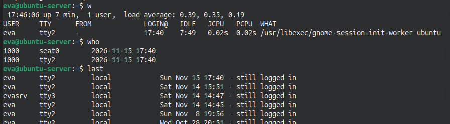
 

#### 3.3 - створіть дві нові групи користувачів - super_admins, noob_users та good_students, визначте їх ідентифікатори;
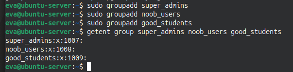
 

#### 3.4 - для кожного члену Вашої команди за допомогою терміналу створіть нового користувача (якщо працюєте самі, то просто трьох довільних користувачів), не забудьте після створення нового користувача одразу задати йому пароль;
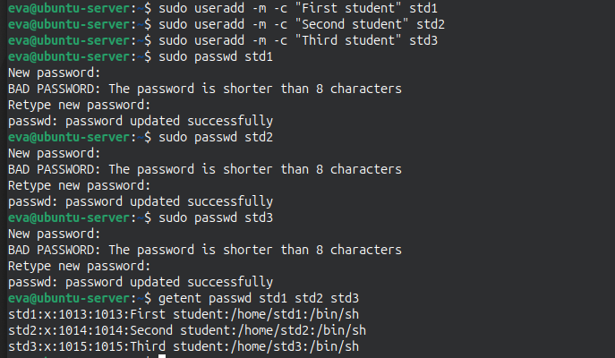
 

#### 3.5 - додайте нових користувачів у створені Вами нові групи таким чином, щоб у групах super_admins та noob_users було по 2 користувачі, один з яких є в обох групах, у групу good_students додайте всіх трьох користувачів;
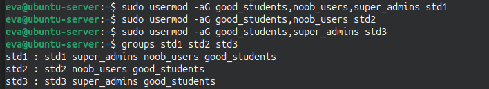
 

#### 3.6 - перегляньте інформацію про групи, та які користувачі до них входять, поясніть що ви бачите;
##### Перше поле - це назва групи, друге `x` - позначка, що пароль групи не зберігається в цьому файлі, третє - GID, четверте - список користувачів, які є учасниками групи
 
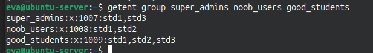
 

#### 3.7 - видаліть першого створеного вами користувача, перегляньте чи залишиться інформація про нього в групах, де він перебував;
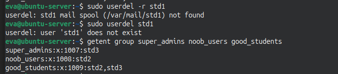
 

#### 3.8 - видаліть другого користувача, перегляньте чи залишиться інформація про нього в групах, де він перебував; 
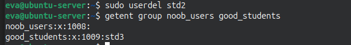
 

#### 3.9 - видаліть третього користувача, перегляньте чи залишиться інформація про нього в групах, де він перебував; 
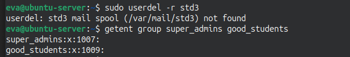
 

#### 3.10 - перегляньте інформацію про існуючі групи користувачів;
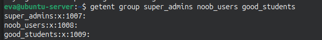
 

#### 3.11 - видаліть створені Вами групи користувачів;
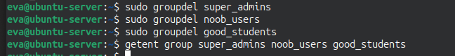
 

#### 3.12 - перегляньте інформацію про існуючі групи користувачів.
 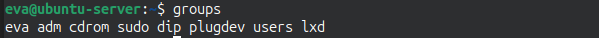
 
 

### Контрольні запитання

#### 1. Чому в конфігураційних файлах паролі не зберігається в явному вигляді?
##### У файлі /etc/passwd у другому полі стоїть лише `x` - позначка того, що пароль зберігається в окремому файлі /etc/shadow. Перший файл доступний для читання всім, а /etc/shadow звичайні користувачі переглядати не можуть. Також сам пароль у /etc/shadow зберігається як одностороннє шифрування.
 

#### 2. Чому не рекомендується виконувати повсякденні операції, використовуючи обліковий запис root?
##### Тому що можна забути, що ви працюєте як root, і виконати команду, яка завдасть шкоди системі. Також команди, які спокійно могли виконуватись з облікового запису звичайного користувача можуть наробити шкоди з облоковим записом root. Тому команди від root виконують лише тоді, коли потрібні адміністративні привілеї (через `sudo` чи `su`)
 

#### 3. У чому відмінність механізмів отримання особливих привілеїв su і sudo?

| Ознака | `su` | `sudo` |
|---|---|---|
| Що виконує | запускає оболонку від імені іншого користувача, у ній виконується ціла серія команд | виконує одну команду від імені root |
| Який пароль вводиться | користувача, на якого перемикаються | поточного користувача |
| Налаштування | потрібен увімкнений обліковий запис root | потрібне налаштування `sudo` адміністратором |
| Завершення | потрібно вийти командою `exit`, інакше сеанс залишається з правами поточного користувача | права діють лише для команди з префіксом `sudo`, після ввімкнення ще певний час пароль повторно не запитується |
| Облік дій | немає запису про виконані команди | кожна команда записується в журнал (користувач, команда, дата й час) |
| Ризик помилки | легко випадково залишитися в оболонці root | низький, бо виконання команди з правами адміністратора буде містити префікс `sudo` |
 

#### 4. Чому домашній каталог користувача root не розміщено в каталозі /home?
##### Домашній каталог root - це каталог, розташований в корені файлової системи, а не в /home. /home часто розташований на окремому розділі чи мережевому ресурсі, який може бути не змонтований. А адміністратор root у будь-якому випадку повинен мати робочий домашній каталог у кореневій файловій системі, щоб мати змогу працювати
 

#### 5. Для чого використовується команда getent?
##### Команда `getent` отримує записи з баз даних облікових записів, таких як `passwd`, `shadow`, `group`. Її відмінність від `grep` в тому, що вона шукає не лише в локальних файлах, а й у мережевих службах каталогів (LDAP, NIS, Windows Domain, Active Directory)
 

#### 6. Як можна змінити пароль користувача?
- Якщо користувач сам змінює свій пароль, то виконує `passwd` без аргументів. Система запитує поточний пароль, а потім новий
- Якщо адміністратор змінює пароль користувача, то виконує `sudo passwd ім'я_користувача`, задає новий пароль
- Якщо через графічні засоби -> керування користувачами
 

#### 7. Яким чином можна видалити існуючі групи користувачів? Чи залишиться інформація про них десь у системі?
##### Групу видаляють командою `groupdel` з назвою групи. Можна видалити лише групу, яка не є основною групою жодного користувача. Інформація про групу зникає з файлу /etc/group, але файли, які належали групі, залишаються "сиротами" - власник-група відображається лише числовим GID
 

#### 8. Яке призначення команди chage?
##### Команда `chage` керує інформацією про "старіння" паролів (password aging), яка зберігається в /etc/shadow: терміном дії пароля, попередженнями, строком неактивності та терміном дії облікового запису
| Параметр | Призначення |
|---|---|
| `-l` | показати параметри "старіння" облікового запису |
| `-d` | задати дату останньої зміни пароля |
| `-E` | задати дату закінчення дії облікового запису |
| `-I` | скільки днів після спливу пароля ще можна входити |
| `-m` | мінімальний інтервал між змінами пароля |
| `-M` | максимальний термін дії пароля |
| `-W` | за скільки днів до спливу пароля почати попереджати |
 

#### 9. Які параметри команди usermod ви вважаєте найбільш використовуваними?
##### Я вважаю найбільш використовуваними параметри `-aG` (додати до додаткових груп), `-g` (змінити основну групу), `-s` (змінити оболонку входу), `-L`/`-U` (заблокувати/розблокувати користувача), `-l` (змінити ім'я для входу), `-c` (додати коментар)
 
 

### Висновки
##### While completing LabWork №9, I learned how Linux protects the system and it's users. I studied the difference between the `su` and `sudo` commands, the structure of the `/etc/passwd`, `/etc/shadow` and `/etc/group` files and the commands `id`, `who`, `w`, `last` and `getent` for viewing user information. I learned how to create, modify and delete groups with `groupadd`, `groupmod` and `groupdel`, and how to create users, set passwords, change group memberships and delete users with `useradd`, `passwd`, `usermod` and `userdel`. In practice, I created three groups and three users, distributed them among the groups and checked what happens to the group lists after users are deleted
