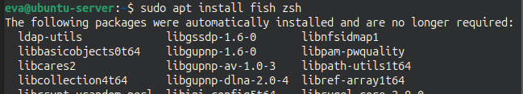
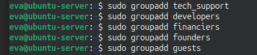
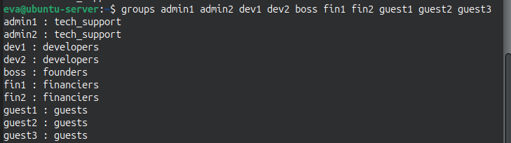
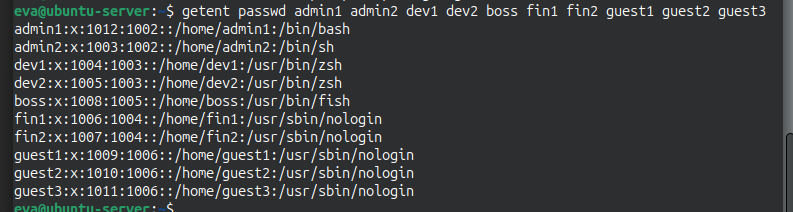
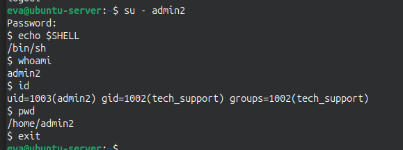
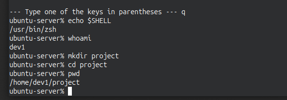
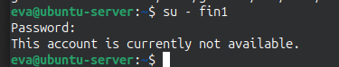
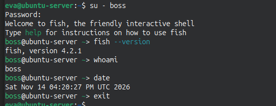
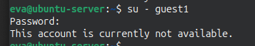

> Оформлено сдуденткою  
> групи KСM-43б   
> Адаменко Є. В.  

<h1 align="center">Work-case №6</h1>

### Завдання 1 - В робочому просторі операційної системи необхідно встановити декілька командних інтерпретаторів (окрім bash ще 2 на ваш вибір):
> ###### я обрала zsh та fish
#### 1.1 Якими командами це можна зробити;
##### Встановити додаткові командні інтерпритатори можна за допомогою команд
```
sudo apt update
sudo apt install zsh fish
```

##### Для перевірки встановлення: `zsh --version`
<br>

#### 1.2 Опишіть коротко можливості кожного з них.
##### bash - оболонка за замовчуванням у більшості дистрибутивів. Підтримує скрипти, історію команд, автодоповнення клавішею Tab, псевдоніми (`alias`), керування завданнями (`jobs`, `fg`, `bg`)
##### Z shell (zsh) - розширена оболонка, сумісна з bash. Має потужніше автодоповнення з підказками параметрів команд, виправлення помилок у командах, розширені шаблони імен файлів, теми та плагіни
##### friendly interactive shell (fish) -  оболонка, орієнтована на зручність: автопідказки на основі історії команд, підсвічування синтаксису, розумне автодоповнення, налаштування через веб-інтерфейс (`fish_config`). Синтаксис скриптів відрізняється від bash і не повністю з ним сумісний
<br>
<br>

### Завдання 2 - Необхідно створити 10 нових користувачів у вашій системі та розподілити їх по групам:
- Technical support (технічна підтримка, системні адміністратори);
- Developers (розробники, технічні спеціалісти свого профілю);
- Financiers (бухгалтерія, економісти тощо);
- Founders (керівництво);
- Guests (гості).
##### Для створення груп я використала команди:
```
sudo groupadd tech_support
sudo groupadd developers
sudo groupadd financiers
sudo groupadd founders
sudo groupadd guests
```

<br>

##### Для створення нових користувачів я скористалась командою `sudo useradd` та параметрами -m (створення домашнього каталогу користувача), -g (додавання користувача у групу), -s (командний інтерпритатор за замовчуванням)
```
sudo useradd -m -g tech_support -s /bin/bash admin1
sudo useradd -m -g tech_support -s /bin/bash admin2
sudo useradd -m -g developers -s /usr/bin/zsh dev1
sudo useradd -m -g developers -s /usr/bin/zsh dev2
sudo useradd -m -g developers -s /usr/bin/zsh dev3
sudo useradd -m -g financiers -s /usr/sbin/nologin fin1
sudo useradd -m -g financiers -s /usr/sbin/nologin fin2
sudo useradd -m -g founders -s /usr/bin/fish boss
sudo useradd -m -g guests -s /usr/sbin/nologin guest1
sudo useradd -m -g guests -s /usr/sbin/nologin guest2
sudo useradd -m -g guests -s /usr/sbin/nologin guest3
```

<br>
<br>

### Завдання 3 - Для кожного з користувачів визначити його командний інтерпретатор за замовчуванням:
- Technical support – bash;
- Developers – командний інтерпретатор 1 (завдання 1);
- Financiers – заборонити доступ до командних інтерпретаторів;
- Founders – командний інтерпретатор 2 (завдання 1);
- Guests – заборонити доступ до командних інтерпретаторів.
> це завдання я виконала при створенні нових користувачів


<br>
<br>

### Завдання 4 - Продемонструвати приклади роботи кожної групи користувачів у своєму командному інтерпретаторі – наприклад збір відомостей про систему, визначення базової конфігурації, системної дати, поточних каталогів тощо.

<br>

<br>

<br>

<br>

<br>
<br>

## Висновки
##### While completing workcase 6, I installed 2 additional command shells (zsh and fish) and compared their features with bash. I created 5 groups and 10 users, assigned a default shell to each group (bash, zsh, fish) and denied shell access to the financiers and guests with the `nologin` shell. I demonstrated how each group works in its own shell by gathering system information commands and by working with directories
