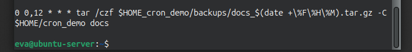
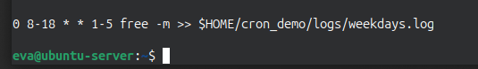
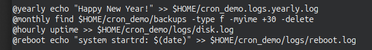
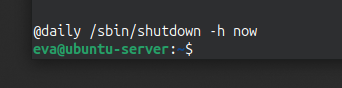
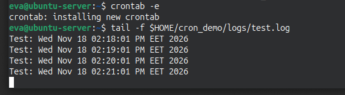
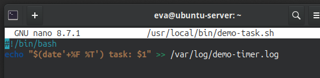
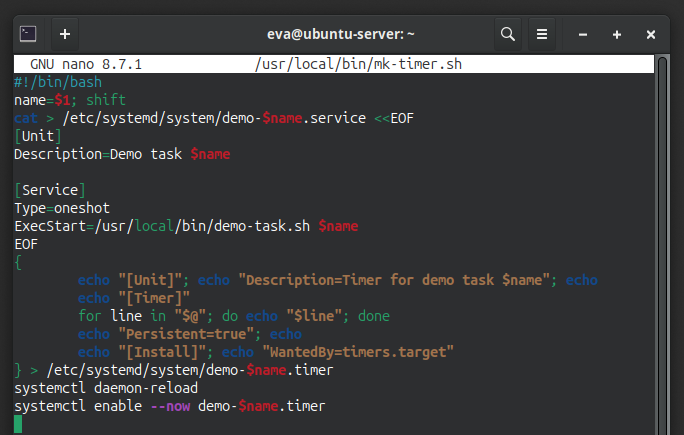
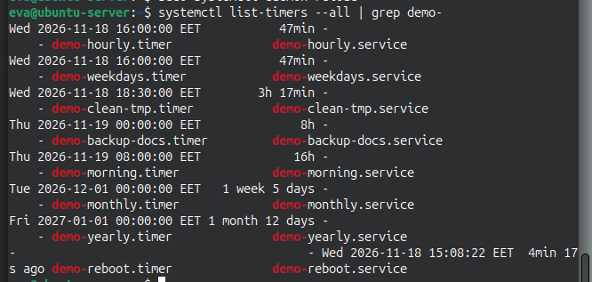
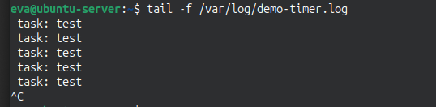

> Оформлено сдуденткою  
> групи KСM-43б   
> Адаменко Є. В.  

<h1 align="center">Work-case №7</h1>

### Завдання 1 - В ході роботи досить часто виникає завдання планування задач:
#### 1.1 Охарактеризуйте основні функції які може виконувати планувальник завдань в будь-якій ОС. Порівняйте можливості планування завдань в різних ОС на прикладі Windows та Linux.
##### Зазвичай планувальники використовують для резервного копіювання, архівування, очищення тимчасових каталогів, видалення старих файлів, перевірки оновлень, запуску звітів, вимкнення чи перезавантаження комп'ютера 
##### Основні функції:
- запуск у задані час і дату - одноразово чи за розкладом - щодня, щотижня, щомісяця, щороку
- запуск за подіями - при старті системи, вході користувача, простої комп'ютера, появі запису в журналі, тощо
- запуск від імені певного користувача
- повторення завдання з заданим інтервалом та обмеження часу його виконання
- ведення журналу виконання і сповіщення про результат чи помилки

| Ознака | Windows | Linux |
|---|---|---|
| Основний засіб | планувальник завдань (Task Scheduler) - графічна програма taskschd.msc, командний рядок schtasks, PowerShell | cron (`at`, `anacron`, systemd timers) |
| Тригери | за часом, після входу користувача, під час запуску системи, при простої, за подією з журналу подій, при блокуванні/розблокуванні сеансу | cron - за часом і `@reboot`. systemd timers: за календарем, через певний час після завантаження. `at` - одноразово |
| Дії | запуск програми або скрипта | запуск будь-якої команди чи скрипта |
| Умови виконання | живлення від мережі, наявність мережі, простій, пробудження комп'ютера для виконання | cron: реалізують у скрипті. systemd: умови `Condition…` та залежності між службами |
| Пропущені запуски | є параметр "запустити завдання якнайшвидше після пропущеного запуску" | cron пропущені запуски не виконує, їх виконують `anacron` та systemd timers з `Persistent=true` |
| Варіанти запуску | від імені користувача, з входом у систему, з найвищими привілеями | crontab - кожного користувача або системні розклади (root) |
| Зберігання завдань | бібліотека завдань (XML) | текстові файли `crontab`, `/etc/cron.d/`, unit-файли |
| Журнали | журнал подій Windows, історія завдання | системний журнал (`journalctl`, `/var/log/syslog`) |
<br>

#### 1.2 Опишіть основні принципи роботи з планувальником Cron в ОС Linux. Як його налаштовувати? Чи є йому альтернативи (дайте їх характеристику).
##### Cron - це служба, яка запускається разом із системою і щохвилини перевіряє crontab-файли. Якщо поточний час збігається з розкладом якогось запису, виконується вказана команда
##### Основні команди:
- `crontab -e` - редагувати crontab поточного користувача (при першому запуску пропонує вибрати редактор)
- `crontab -l` - показати поточний розклад
- `crontab -r` - видалити весь розклад
- `sudo crontab -e` - розклад користувача root
- `sudo crontab -u користувач -e` - розклад вказаного користувача
- `systemctl status cron` - стан служби cron

##### Спеціальні символи:
- `*` - будь-яке значення
- `,` - перелік 
- `-` - діапазон 
- `/` - крок (наприклад `*/15` - кожні 15 хвилин)

##### Скорочені записи: `@reboot` (під час запуску системи), `@hourly`, `@daily`, `@weekly`, `@monthly`, `@yearly`.

##### Додаткові правила та можливості:
- у crontab потрібно використовувати повні шляхи до команд і файлів
- вивід команди за замовчуванням надсилається поштою; щоб записати його у файл, додають перенаправлення `>> файл.log 2>&1`
- доступ до cron можна обмежити файлами `/etc/cron.allow` та `/etc/cron.deny`
- результати запусків дивляться командою `journalctl -u cron` або `grep CRON /var/log/syslog`

##### Альтернативи cron:
- at/batch - одноразове виконання завдання в заданий час. batch виконує завдання, коли навантаження системи низьке
- anacron - призначений для комп'ютерів, які не працюють постійно. Виконує періодичні завдання (щодня, щотижня, щомісяця)
- systemd timers - таймери в складі systemd - календарні та відносно завантаження, є залежності між службами, обмеження ресурсів. Завдання описують двома unit-файлами: `.service` і `.timer`
- fcron - замінник cron, який поєднує можливості cron і anacron (виконує пропущені завдання, підтримує умови запуску)
<br>
<br>

### Завдання 2 -  Для вашої віртуальної машини зі встановленою ОС Linux здійсніть планування обраних вами задач (запуск додатків, вмикання/вимикання машини, очистка каталогів, видалення файлів, резервне копіювання, архівування тощо на ваш вибір) через планувальник Cron:
#### 2.1 Виконання спланованої задачі в чітко визначений Вами час (наприклад о 8 ранку, 18.30 і т.д.).
> ###### Для цього завдання я обрала щодня о 8 ранку записувати повідомлення в журнал за допомогою команди `0 8 * * * echo "Morning task: $(date)" >> $HOME/cron_demo/logs/morning.log`. 
> ###### А в 18:30 очищати тимчасові каталоги командою `30 18 * * * find $HOME/cron_demo/tmp -type f -name "*.tmp" -delete`

<br>
<br> 

#### 2.2 Виконання однієї й тієї ж задачі двічі в день (час також визначаєте самостійно).
> ###### Для цього завдання я обрала резервне копіювання (в архів) даних об 0:00 та 12:00 щодня командою `0 0,12 * * * tar -czf $HOME/cron_demo/backups/docs_$(date +\%F_\%H\%M).tar.gz -C $HOME/cron_demo docs`

<br>
<br>

#### 2.3 Виконання однієї й тієї ж задачі тільки в будні (або тільки у вихідні дні) у чітко визначений проміжок часу (наприклад з 8 до 18 години).
> ###### Для цього завдання я обрала щогодинні записи використання пам'яті з 8 до 18 год. Команда: `0 8-18 * * 1-5 free -m >> $HOME/cron_demo/logs/weekdays.log`

<br>
<br>

#### 2.4 Виконання задач тільки раз у рік, раз у місяць, раз у день, щогодини, при вмиканні (після перезавантаження).
> ###### Для цього завдання я використовувала скорочення. Для щорічного завдання вивела повідомлення "Happy New Year". Для щомісячного - очищення старих резервних копій. Для щогодинного - моніторинг часу робобти та навантаження системи. А при кожному запуску системи я обрала запис у журнал час запуску. 

<br>

> ###### Щоденне завдання я вирішила виконати через `sudo crontab -e` - вимикання машини кожного дня в 0:00.

<br>

##### Також щоб перевірити чи працює планувальник я створила додаткову задачу, що мала записувати час щохвилини. Для встановлення цього сценарцю я скористалась командою `* * * * * echo "Test: $(date)" >> $HOME/cron_demo/logs/test.log`

<br>
<br>

### Завдання 3 - Встановіть альтернативний Cron’у планувальник задач (на Ваш вибір). Виконані у завданні 2 дії продемонструйте через нього.
##### Для виконання завдання я обрала systemd timers. Перевірила чи встановлений планувальник командою `systemctl --version`.
##### Для планування завдань треба окремо створювати файли в nano та самі таймери. Systemd timers працюють за принципом того, що кожне заплановане завдання описується двома файлами в /etc/systemd/system/, де є назва.service (що саме виконувати) та назва.timer (коли виконувати).
##### Перед початком роботи я створила файл nano командою `sudo nano /usr/local/bin/demo-task.sh` та записала туди скрипт, який буде запускати створені таймери. 
```
#!/bin/bash
echo "$(date '+%F %T') task: $1" >> /var/log/demo-timer.log
```

##### Надала права на використання цього скрипта командою `sudo chmod +x /usr/local/bin/demo-task.sh`. Далі я написала допоміжний скрипт, що має створювати пару `.service` та `.timer` за назвою й розкладом. Це для того, щоб кожен раз не писати файли вручну. Команда для створення нового файлу nano `sudo nano /usr/local/bin/mk-timer.sh`. І також надала права на використання.

<br>

##### Після налаштування я перейшла до створення таймерів командами 
```
sudo mk-timer.sh morning "OnCalendar=*-*-* 08:00:00"
sudo mk-timer.sh clean-tmp "OnCalendar=*-*-* 18:30:00"
sudo mk-timer.sh backup-docs "OnCalendar=*-*-* 00,12:00:00"
sudo mk-timer.sh weekdays "OnCalendar=Mon..Fri *-*-* 08..18:00:00"
sudo mk-timer.sh yearly "OnCalendar=yearly"
sudo mk-timer.sh monthly "OnCalendar=monthly"
sudo mk-timer.sh hourly "OnCalendar=hourly"
sudo mk-timer.sh reboot "OnBootSec=30sec"
```
##### Перевірила створення таймерів командою `systemctl list-timers --all | grep demo`

<br>

##### Для того, щоб перевірити правильність налаштування і коректну роботу таймерів я створила ще один тестовий таймер, але вже в systemd timers командою `sudo mk-timer.sh test "OnCalendar=*-*-* *:*:00"`, а потім запустила відстежування журналу командою `tail -f /var/log/demo-timer.log`.

<br>
<br>

### Висновок
While completing workcase №7, I studied the main functions of task schedulers and compared Windows Task Scheduler with the Linux schedulers. I learned how cron works and its crontab format, and I scheduled tasks at an exact time, twice a day, on weekdays and weekends within a time range, and once a year, a month, a day, an hour and at reboot. As an alternative, I used systemd timers and reproduced the same schedules with them